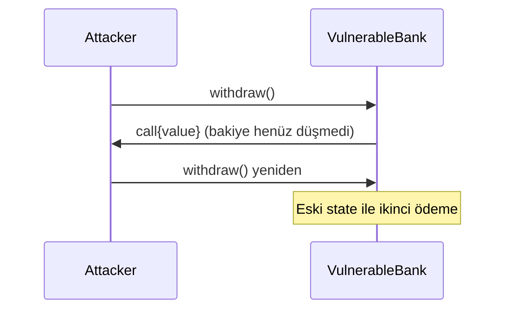

# Solidity Reentrancy Security — CEI + ReentrancyGuard Örnek Projesi

Klasik reentrancy açığını, **Checks-Effects-Interactions** düzeltmesini, OpenZeppelin **ReentrancyGuard** katmanını ve **pull payment** yaklaşımını Foundry ile gösteren eğitim deposu.

**Proje kökü:** `solidity-reentrancy-security/` (`d:\SoftWare\solidity-reentrancy-security`)

## Bu Proje Neyi Gösteriyor?

- Reentrancy saldırısının kontrol akışı (`receive` / `fallback` ile yeniden giriş)
- Güvensiz vault: Interaction → Effect sırası
- Güvenli vault: Checks-Effects-Interactions + `nonReentrant`
- Pull payment: hak kaydı ve ayrı çekim
- Saldırgan kontrat ile otomatik test
- OpenZeppelin Contracts **5.x** `ReentrancyGuard`

## Neden Reentrancy Önemli?

Harici bir çağrı yalnızca veri göndermez; yürütme kontrolünü karşı tarafa verir. Bakiye veya hak, dış çağrıdan **sonra** güncelleniyorsa aynı hak birden fazla kez kullanılabilir. CEI state sırasını güvene alır; ReentrancyGuard kritik entry point’lerde ikinci kilit sağlar. İkisi birbirinin yerine değil, tamamlayıcısıdır.

## Kontrol Akışı (özet)



## Proje Yapısı

```text
solidity-reentrancy-security/
├─ src/
│  ├─ VulnerableBank.sol
│  ├─ SafeBank.sol
│  ├─ PullPaymentBank.sol
│  └─ Attacker.sol
├─ test/
│  └─ Reentrancy.t.sol
├─ script/
│  └─ DeploySafeBank.s.sol
├─ .env.example
├─ foundry.toml
├─ README.md
├─ SECURITY.md
├─ CHANGELOG.md
└─ LICENSE
```

**Toolchain:** Foundry (`forge`, `cast`, `anvil`). Hardhat kullanılmaz.

## Sürümler

| Bileşen | Sürüm |
|---------|--------|
| Solidity (solc) | 0.8.28 (`pragma ^0.8.20`) |
| OpenZeppelin Contracts | 5.4.0 (`ReentrancyGuard`) |

## Sözleşmeler

| Dosya | Açıklama |
|-------|----------|
| `VulnerableBank` | Bilerek güvensiz `withdraw` (eğitim) |
| `SafeBank` | CEI + `ReentrancyGuard` |
| `PullPaymentBank` | `queueWithdrawal` / `withdrawPending` |
| `Attacker` | Ödeme alınca hedefe yeniden giren test kontratı |

## Başlangıç

Gereksinimler: [Foundry](https://book.getfoundry.sh/), Git.

```bash
git clone https://github.com/HoLyDreaM/solidity-reentrancy-security.git
cd d:\SoftWare\solidity-reentrancy-security
forge install
```

## Environment

```bash
cp .env.example .env
```

Yalnızca yerel placeholder değerler kullanın. Gerçek mainnet private key koymayın. `.env` gitignore’dadır.

## Compile / Test

```bash
forge fmt
forge build
forge test -vvv
```

### Test senaryoları

- Güvensiz vault’ta saldırganın fazla fon çekmesi
- Güvenli vault’ta saldırının revert etmesi ve invariant’ların korunması
- Dürüst kullanıcının `SafeBank.withdraw` ile çekimi
- Pull modelinde kuyruk + çekim

## Local Deploy (opsiyonel)

```bash
anvil
forge script script/DeploySafeBank.s.sol:DeploySafeBank --rpc-url http://127.0.0.1:8545 --broadcast
```

## Güvenlik Notu

- Demo deposu; audit iddiası yok; gerçek fon yönetmez
- `VulnerableBank` yalnızca laboratuvar / test içindir
- Mainnet dağıtım bu örneğin kapsamı dışındadır

Ayrıntı: `SECURITY.md`.

## İlgili Makaleler

### Solidity Reentrancy Güvenliği: 7 Adımda Güvenli Smart Contract Tasarımı

https://www.mehmet-ozdemir.com.tr/solidity-reentrancy-guvenligi/

### Solidity Upgradeable Smart Contract: 7 Adımda Güvenli Proxy Tasarlama Rehberi

https://www.mehmet-ozdemir.com.tr/solidity-upgradeable-smart-contract-7-adimda-guvenli-proxy-tasarlama-rehberi/

### UUPS Proxy: 7 Adımda Güvenli Upgradeable Smart Contract Mimarisi

https://www.mehmet-ozdemir.com.tr/uups-proxy-7-adimda-guvenli-upgradeable-smart-contract-mimarisi/

## Yazar

Mehmet Özdemir

Web Sitesi: https://www.mehmet-ozdemir.com.tr/

## Lisans

MIT — Copyright (c) Mehmet Özdemir. Ayrıntı: `LICENSE`.
